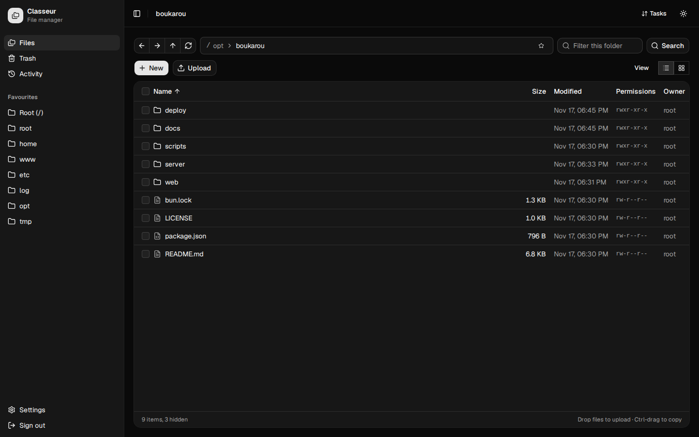
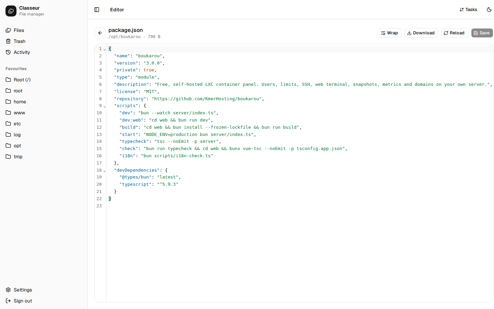

<div align="center">


# Classeur

**Your server's files, in the browser.**

A web file manager for Linux servers.<br>
Browse, upload, edit, compress and organise files without FTP, SSH tunnels or outside services.

[](package.json)
[](LICENSE)
[](#requirements)
[](https://bun.sh)
[](web)

[Install](#install) · [Features](#features) · [Using a domain](#using-a-domain-name) · [Report a bug](https://github.com/toscani-tenekeu/classeur/issues/new)



</div>

---

## Features

| | |
| --- | --- |
| **Browse** | List or grid view, sorting by any column, hidden files on request, favourite folders, a clickable or typed path, and search by name, extension, size or date, with your own size in MB or number of days. A search can be stopped at any time. |
| **Organise** | New files and folders, rename, copy, move, links, drag and drop between folders, and actions on many items at once. Long copies, moves, deletions, archives and downloads run as tasks: the **Tasks** menu shows progress, speed, time left and the file being worked on, and cancelling stops the work at once and removes anything half-made. |
| **Trash** | Deleted items wait 30 days and can be restored. Permanent deletion is there when you choose it. |
| **Upload and download** | Files or whole folders by drag and drop, sent in parts so large files survive a shaky connection. Download a file, or several as one zip. Download a web address straight to the server. |
| **Archives** | Make zip, tar.gz and tar.xz; look inside and extract zip, tar, tar.gz, tar.xz, tar.bz2, tar.zst, gz, xz, bz2, 7z and rar. |
| **Edit and preview** | A code editor with syntax highlighting for configuration files, scripts and source code; previews for images, video, audio, PDF and the end of large log files. |
| **Where a file is used** | The details of a file say whether a website serves it (nginx, Apache or Caddy, with its address and the pages that link to it), whether it sits in an old release of a site, in a project and its git state, or is open in a program, so you can tell what is safe to delete. |
| **Permissions** | Change permissions with checkboxes or a number like 755, separately for files and folders, and change owner and group, optionally for everything inside. |
| **Activity and updates** | A record of everything done from Classeur, and updates installed from the interface, on request or automatically. |

<div align="center">

</div>

## Safety

- Every action that changes or removes something asks for confirmation and says what will happen.
- The operating system's own folders (`/boot`, `/usr`, `/bin`, `/lib` and the like) and the kernel's live views (`/proc`, `/sys`, `/dev`, `/run`) can be browsed and downloaded but not changed.
- Folders the system needs, such as `/etc`, `/var` or a user's home folder, can be filled and emptied but not removed themselves.
- Deleting a folder that contains a mounted disk is refused.
- Files that can lock you out of the server, such as `sudoers`, `sshd_config` or `fstab`, carry a warning, and `sudoers` and `sshd_config` are checked by their own programs before a change is saved.
- Previews of uploaded pages and images are locked down, so a file can never run code in your session.

## Requirements

- A 64-bit Linux server (x86-64 or ARM64) with Linux 5.1 or newer
- Root access
- About 1 GB of free memory while installing or updating, to build the interface
- One of: Debian, Ubuntu, Linux Mint, RHEL, Rocky Linux, AlmaLinux, CentOS Stream, Fedora, Oracle Linux, Amazon Linux 2023, openSUSE, Arch Linux, Manjaro or Alpine Linux

## Install

```bash
curl -fsSL https://raw.githubusercontent.com/toscani-tenekeu/classeur/main/install.sh | sudo bash
```

The script installs the archive tools and [Bun](https://bun.sh) with your
distribution's package manager, downloads Classeur to `/opt/classeur`, builds the
interface and starts it as a systemd service (OpenRC on Alpine). When it
finishes it prints:

```
Setup link:      http://203.0.113.10:7080/setup?token=…
Admin password:  …
```

On RHEL, Rocky, AlmaLinux and Oracle Linux, 7-Zip comes from EPEL. Without it,
everything works except opening `.7z` and `.rar` archives; add it later with
`dnf install epel-release && dnf install p7zip p7zip-plugins`.

Open the setup link once to choose your own password. If you would rather keep
the generated password, sign in with it; the link stops working either way.

The same information is kept in `/opt/classeur/data/first-run.txt` until setup is
done.

Classeur runs as root so it can manage every file on the server. Protect it with
a strong password and, ideally, HTTPS.

### Settings

Pass these as environment variables to `install.sh`:

| Variable        | Default         | Meaning                                       |
| --------------- | --------------- | --------------------------------------------- |
| `CLASSEUR_DIR`  | `/opt/classeur` | Where Classeur is installed                   |
| `CLASSEUR_HOST` | `0.0.0.0`       | Address to listen on                          |
| `CLASSEUR_PORT` | `7080`          | Port to listen on                             |
| `CLASSEUR_URL`  | none            | Public address, used to print the setup link  |

## Using a domain name

Classeur works with just the server's IP address, but then your password and
your files travel over plain HTTP. A domain name with HTTPS is recommended. Make
Classeur listen locally and put a web server in front of it:

```bash
curl -fsSL https://raw.githubusercontent.com/toscani-tenekeu/classeur/main/install.sh \
  | sudo CLASSEUR_HOST=127.0.0.1 CLASSEUR_URL=https://files.example.com bash
```

```nginx
server {
    server_name files.example.com;

    # Uploads arrive in 8 MB parts.
    client_max_body_size 64m;

    location / {
        proxy_pass http://127.0.0.1:7080;
        proxy_set_header Host $host;
        proxy_set_header X-Forwarded-Proto $scheme;
        proxy_read_timeout 300s;
        proxy_request_buffering off;
        proxy_buffering off;
    }
}
```

Then get a certificate, for example with `sudo certbot --nginx -d files.example.com`.

## Updating

Open **Settings** and choose **Check for updates**, then **Install update**.
Classeur downloads the new version, builds it next to the running one, swaps it
in and restarts. If anything fails, it stays on the version it had.

Turn on **Install updates automatically** to have this done every six hours.

## Day to day

```bash
systemctl status classeur            # is it running (rc-service classeur status on Alpine)
journalctl -u classeur -f            # logs (/var/log/classeur.log on Alpine)
cd /opt/classeur && bun run passwd   # reset a forgotten password
```

## Uninstall

```bash
sudo systemctl disable --now classeur
sudo rm /etc/systemd/system/classeur.service
sudo rm -rf /opt/classeur
```

On Alpine: `rc-update del classeur && rc-service classeur stop && rm /etc/init.d/classeur`.

Items in the trash on other disks are kept in a `.classeur-trash` folder at the
top of each disk; remove those too if you want nothing left behind.

## How it is built

- **Server**: [Bun](https://bun.sh), with its built-in SQLite driver. No other runtime dependencies.
- **Interface**: Vue 3 with [shadcn-vue](https://www.shadcn-vue.com) components, Tailwind CSS and CodeMirror.
- **Data**: one SQLite file in `data/`, holding the password hash, sessions, settings, the trash index and the activity record (90 days).

System programs are always started with an explicit argument list and never
through a shell.

### Development

```bash
bun install && (cd web && bun install)
bun run build          # build the interface once
bun run dev:server     # API on http://127.0.0.1:7080
bun run dev:web        # interface with hot reload, proxying /api
```

## License

MIT
